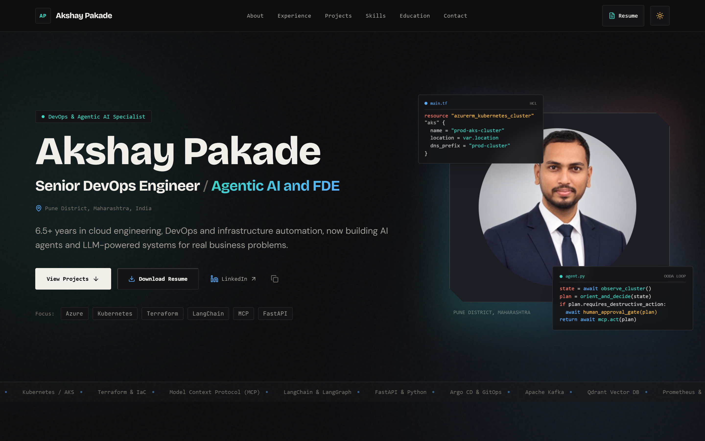

# Akshay Pakade | Portfolio & ATS Resume

Personal portfolio and ATS resume web application for **Akshay Pakade**, Senior DevOps Engineer transitioning into **Agentic AI** and **Forward Deployed Engineering (FDE)**.

Built with a bespoke human aesthetic featuring multi-colour mixable tokens, self-hosted Bricolage Grotesque, Instrument Serif, DM Sans, interactive 3D tilted project cards with shared-element modal animations, and an exact 2-page A4 ATS resume.



---

## Tech Stack

- **Framework**: Vite + React 19 + TypeScript
- **Smooth Scroll**: Lenis
- **Motion**: Framer Motion (page load reveal, shared-element `layoutId` modal animation, cards stagger)
- **Styling**: Tailwind CSS v4 + Custom Multi-Colour Design System
- **Typography**: Self-hosted `@fontsource/bricolage-grotesque`, `@fontsource/instrument-serif`, `@fontsource/dm-sans`, and `@fontsource/jetbrains-mono`
- **Icons**: Lucide Icons & Crisp Line SVGs (no emojis)
- **Routing**: React Router v7 (`/`, `/resume`, `/privacy`, `/terms`, `*`)
- **Image Pipeline**: Real portrait (`public/images/akshay.png`) processed with Sharp into AVIF, WebP, and JPEG, LQIP blurred placeholder, plus 7 project cover art assets at 1600 & 800px width
- **PDF Engine**: Puppeteer-core via local Chromium/Chrome for static ATS resume builds (strict 2 pages A4)
- **Static Prerendering**: Puppeteer static HTML prerendering for SEO across static routes (`/`, `/resume`, `/privacy`, `/terms`, `/404`)

---

## Quickstart & Development

### 1. Prerequisites
- Node.js 18+ (tested on Node v20.20.0)
- Google Chrome or Microsoft Edge (for static resume PDF generation and prerendering)

### 2. Install Dependencies
```bash
npm install --legacy-peer-deps
```

### 3. Run Development Server
```bash
npm run dev
```
Open [http://localhost:5173/](http://localhost:5173/) in your browser.

### 4. Build Production Bundle with Integrity Verification
```bash
npm run build
```
This automatically runs `npm run check` (verifies zero emojis, no em dashes, no lorem ipsum, no TODOs, and no urn:li references) followed by TypeScript typechecking, Vite production packaging, dynamic sitemap/robots generation, and static route prerendering.

### 5. Run End-to-End Automated Tests
```bash
npm run test:e2e
```
Runs comprehensive viewport checks (320px to 1366px), Desktop Chromium, iPhone 13, Pixel 7 mobile interaction suites, and secondary route hash navigation.

### 6. Generate Static Resume PDF
```bash
npm run build:resume
```
This builds an exact 2-page A4 print layout to [`public/Akshay_Pakade_Resume.pdf`](file:///public/Akshay_Pakade_Resume.pdf).

### 7. Process Real Photos & Project Covers
```bash
npm run build:images
node scripts/generate-covers.mjs
```

---

## Design Direction: Multi-Colour "Crystal"

- **Colour System**: Teal (`#3DD6C3`), Sky (`#5AB0FF`), Amber (`#F6B945`), Coral (`#FF7A66`).
- **Dark Theme**: Warm near-black (`#0C0C0E`), surface (`#141416`), text (`#F2EFEA`), muted (`#A19D96`).
- **Light Theme**: Warm paper (`#F6F3EE`), surface (`#FFFFFF`), text (`#151412`).
- **Typography**: Display in Bricolage Grotesque, italic serif accents in Instrument Serif, body copy in DM Sans, and monospace exclusively for code, dates, and tech tags.
- **Micro-Interactions**: Custom trailing ring cursor with hover and project triggers, 3D tilt on project cards with glare reflection, and floating syntax-highlighted code cards (`main.tf` and `agent.py`) overlapping the portrait.
- **Projects Section**: 3-column responsive grid with filter tabs (*All*, *AI*, *Infrastructure*). Clicking any card triggers a shared-element `layoutId` modal with full description, key points, stack, and inline SVG architecture flow diagrams.
- **Contact Section**: Two-column layout with direct phone and LinkedIn copy buttons, email row (conditional), and message form with honeypot validation and automatic WhatsApp fallback.

---

## Root Cause Analysis and Debug Notes

### Root Cause for Unresponsive Buttons and Links
During initial inspection, elements on the page (such as navigation links, theme toggle button, hero buttons, filter tabs, and project cards) were not responding to click events.
When inspecting with `document.elementFromPoint(x, y)` at the center of these elements:
- The top element returned was `#root` instead of the target buttons.
- Investigation revealed that `.grain-overlay` in `src/index.css` had `pointer-events: none` assigned directly on the parent wrapper element `<div className="flex flex-col min-h-screen grain-overlay">`. Because `pointer-events: none` on a parent element prevents all child pointer interactions unless children explicitly set `pointer-events: auto`, all child interactive elements were blocked from receiving click events.
- **Fix**: Reimplemented `.grain-overlay::before` as an independent fixed pseudo-element with `pointer-events: none` and `z-index: 1`, leaving all DOM child nodes interactive.
- **Lenis Smooth Scroll Hardening**: Refactored Lenis into a unified `LenisProvider` (`src/components/LenisContext.tsx`). Disabled Lenis smoothing on touch devices (`@media (pointer: coarse)`) in favor of native scroll. Added dynamic `lenis.stop()` and `lenis.start()` whenever the mobile drawer or project modal opens or closes, preventing background scroll lock issues.
- **React Router Hash Navigation**: Implemented `ScrollToHashElement` to reliably scroll to target section anchors with a `-80px` offset when navigating to `/#projects` or other section hashes from `/resume`, `/privacy`, and `/terms`.

---

## SEO Checklist

- [ ] **Configure Site Domain**: Set `VITE_SITE_URL` in your environment (defaults to `https://akshaypakade.dev`).
- [ ] **Submit Sitemap in Google Search Console**: Submit `https://your-domain.com/sitemap.xml` in Google Search Console once deployed.
- [ ] **Bing Webmaster Tools Verification**: Set `VITE_BING_SITE_VERIFICATION` and `VITE_GOOGLE_SITE_VERIFICATION` in your deployment environment if needed.
- [ ] **Test with Rich Results Test**: Verify Person, WebSite, ProfilePage, and BreadcrumbList structured data with Google's Rich Results Test tool. Note: phone and email have been strictly excluded from structured data.
- [ ] **PageSpeed Insights & Lighthouse**: Validate Mobile (90+ target) and Desktop performance, accessibility, best practices, and SEO.
- [ ] **Open Graph Debugger**: Test `og:image` (1200x630) using Facebook Sharing Debugger, Twitter Card Validator, and LinkedIn Post Inspector.
- [ ] **LinkedIn Profile Link**: Add your portfolio website link directly to the contact section of your official LinkedIn profile.

---

## Launch Checklist

- [ ] **Add Real Email**: Configure `socialLinks.email` in [`src/data/profile.ts`](file:///src/data/profile.ts) when ready (left empty by default).
- [ ] **Confirm Public Phone**: Confirm phone number `+91 91728 15355` is intended for public display.
- [ ] **Configure Form Endpoint**: Set `contactEndpoint` in [`src/data/profile.ts`](file:///src/data/profile.ts) (e.g. Formspree / Web3Forms) if desired.
- [ ] **Confirm WhatsApp Fallback**: `enableWhatsAppFallback` is enabled by default so submissions open a prefilled WhatsApp chat if no endpoint is configured.
- [ ] **Repository & Live Links**: Add official `repoUrl` and `liveUrl` values in [`src/data/profile.ts`](file:///src/data/profile.ts) when individual project repos/demos become public.
- [ ] **Custom Domain**: Connect your domain and verify canonical link in `index.html`.
- [ ] **Open Graph Card Verification**: Validate 1200x630 card at `https://akshaypakade.dev/og-image.jpg`.

---

## License

This project is licensed under the [MIT License](LICENSE).
